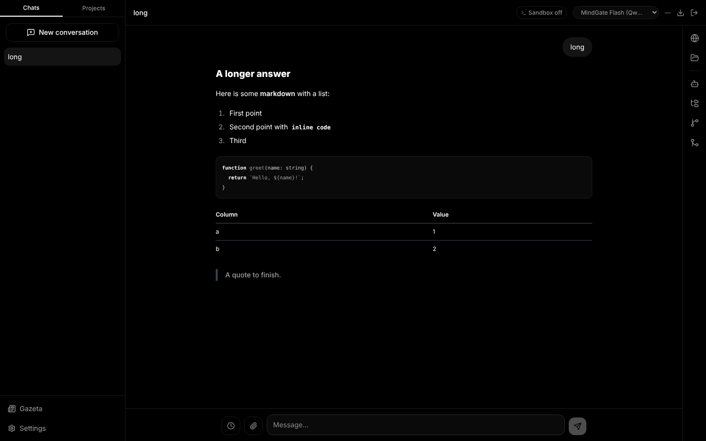
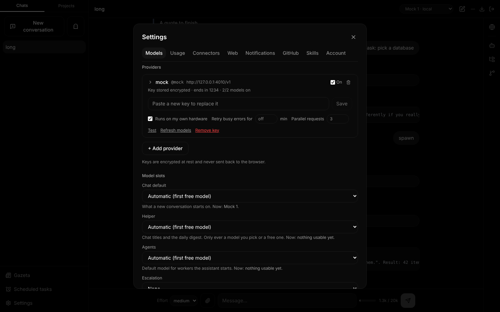
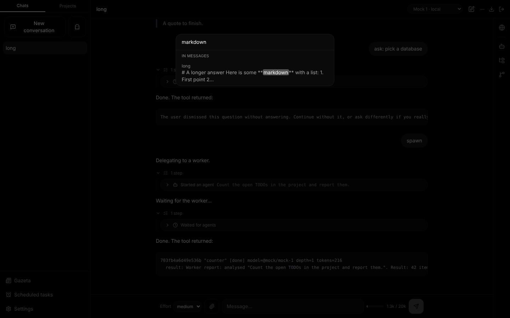
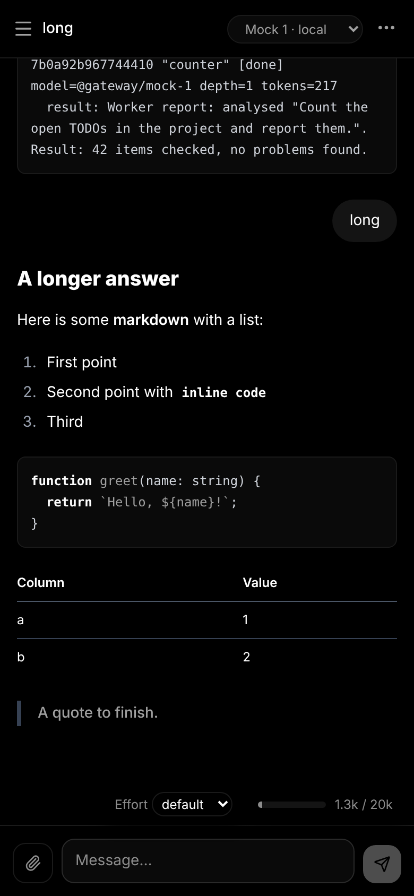
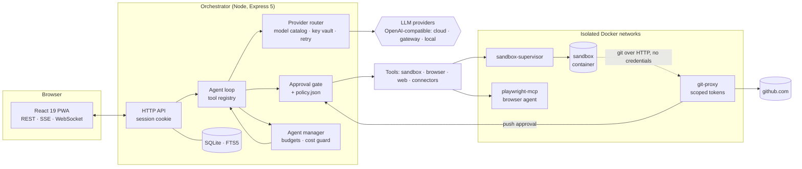

# EverythingApp

[](https://github.com/prod-explore/everything-app/actions/workflows/ci.yml)  

A **self-hosted, bring-your-own-key AI workspace** for one person: multi-provider chat, a sandboxed code agent that can browse the web and work with Git, multi-agent delegation behind a cost guard, and a human-in-the-loop inbox. It is built on one rule: **the model is never trusted — only the action layer is.** Any OpenAI-compatible endpoint works, risky actions go through an approval gate, and the code agent runs in a locked-down container that never sees a key.



**Run it in a minute** — Node 22, no Docker, no API key (a mock model stands in for the LLM):

```bash
git clone https://github.com/prod-explore/everything-app && cd everything-app
(cd cli && npm ci && npm run build) && (cd web && npm ci && npx vite build)
node tools/mock-llm/server.mjs &                     # fake OpenAI-compatible model on :4010
cd cli && SERVER_AUTH_TOKEN=$(openssl rand -hex 32) SERVER_PASSWORD=dev KEY_VAULT_SECRET=$(openssl rand -hex 32) node dist/server.js
```

Open <http://localhost:3000>, log in with `dev`, then add the mock provider ([details](#mock-model-no-docker-no-api-key)).

<table>
<tr>
<td width="50%"><br><sub>Agents ask blocking questions (choices, free text, forms) or park them in the inbox.</sub></td>
<td width="50%"><br><sub>Workers keep their transcript; finished ones stay under <i>Completed</i> and can be resumed.</sub></td>
</tr>
<tr>
<td><br><sub>A provider is a base URL and a key. Chat, helper, agent and escalation models are separate slots.</sub></td>
<td><br><sub>SQLite FTS5 search over every message (Ctrl/⌘+K).</sub></td>
</tr>
<tr>
<td><br><sub>Slash commands in the composer.</sub></td>
<td align="center"><br><sub>Installable PWA, usable at 390 px.</sub></td>
</tr>
</table>

<sub>Screenshots are taken from a seeded local run against a deterministic mock model (`tools/mock-llm`, `tools/screenshots.mjs`), so the replies are canned.</sub>

## What it does

- **Any OpenAI-compatible provider.** A provider is just *base URL + key* — OpenAI, OpenRouter, LM Studio on the LAN, a gateway such as MindGate. There is no vendor SDK and no per-provider code; models are discovered from `GET {base}/models` and can be tagged and overridden. Keys are AES-256-GCM encrypted at rest. Details: [`docs/providers.md`](docs/providers.md).
- **Model slots and a cost guard.** Separate models for chat, helper (titles, digest), agents and escalation. A chat on a `free` model can only start `free` workers unless paid ones are allowed.
- **Multi-agent delegation.** `spawn_agent` / `wait_agents` / `send_message` with per-tree budgets, depth and spawn limits and a kill switch. Finished workers keep their transcript and can be resumed.
- **A sandbox per chat.** A Docker container with no secrets and no `docker.sock` (a project's chats share one). File explorer, a checkpoint before every agent turn and every manual save, rollback, source control and GitHub inside the app.
- **Web access.** `web_search` (SearXNG or Brave), `web_fetch` (page → markdown, no JavaScript) and a Playwright browser agent (several tabs per chat) with a live view you can take over. A URL the model composed itself needs your approval per domain; private networks are unreachable ([ADR 0012](docs/adr/0012-web-access.md)).
- **Pictures.** Attached images, and screenshots the browser agent takes, reach models that can see; for a model that cannot, another model describes them first ([ADR 0015](docs/adr/0015-images-and-vision.md)).
- **Scheduled tasks.** An agent that runs on a cron timetable — or once, or a few times — with nobody watching (“every morning, look for new job offers”) and leaves its result in Gazeta. What needs approval is the same approval card as in a chat, listed in Gazeta; the task either waits for the answer for a set time or goes on without the call. In an ordinary chat the agent can also wake itself up later (`schedule_wakeup`, no approval) or create a scheduled task (with approval) ([ADR 0016](docs/adr/0016-scheduled-tasks.md)).
- **Human in the loop.** Approval cards, blocking and asynchronous questions (the *Gazeta* inbox), `policy.json` for always-allow / always-block, and webhooks (ntfy, Discord, Slack…) when something waits for you.
- **Ghost mode.** A chat or project that never leaves the machine: only models marked local, no web or browser tools. Chosen at creation and impossible to change afterwards — enforced by the database ([ADR 0013](docs/adr/0013-ghost-mode.md)).
- **Long conversations.** A context meter, automatic and manual compaction (older messages become a summary for the model and stay visible), reasoning-effort control, plan proposals the model must get approved, and a task list it keeps.
- **Everyday polish.** Full-text search, Markdown/JSON export, message branching, quoting a selection, slash commands, skills (reusable instructions with their own tool allow-list, auto-approved only for the turns they are attached to), PWA.
- **Operable.** Consistent online backups, retention, schema versions and a network-layer egress guard for the browser ([ADR 0014](docs/adr/0014-data-lifecycle.md), [`deploy/`](deploy)).

Single-user by design: one password, no accounts.

## Architecture



| Package | Role |
|---|---|
| [`cli`](cli) | The orchestrator: HTTP API, agent loop, provider router, approval gate, SQLite. Serves the built UI. |
| [`web`](web) | The React UI ([notes](web/README.md)). |
| [`sandbox-supervisor`](sandbox-supervisor) | The only component that talks to Docker: container lifecycle, exec, files, volumes. |
| [`sandbox-mcp`](sandbox-mcp) | The sandbox's tools (shell, git, checkpoints, terminals) as an MCP server in front of the supervisor. |
| [`playwright-mcp`](playwright-mcp) | Browser agent: domain policy, SSRF guard, deterministic page filtering, live view. |
| [`git-proxy`](git-proxy) | Holds the GitHub credentials the sandbox never sees: scoped tokens, repo binding, push approval, audit. |
| [`tools/mock-llm`](tools/mock-llm) | Deterministic fake model used for the quickstart, tests and screenshots. |

Design decisions are written down as sixteen short ADRs in [`docs/adr`](docs/adr) (message format, policy as a file, sandbox and Git credentials, sessions, the provider catalog, context management, hardening, web access, ghost mode, data lifecycle, images, scheduled tasks…); two are marked superseded.

## Security model

The model is treated as an untrusted component. The boundary is the **action layer**, not the prompt.

1. **Approval gate.** Shell commands, domains the model picked itself, pushes and other side effects become approval cards; grants are scoped (this call / this project / this prefix). Shell commands go through a policy engine (`strict`, `allowlist`, `auto`) and destructive patterns are always blocked. Text-file edits inside the workspace need no approval: a checkpoint is taken first and every edit is audited ([ADR 0010](docs/adr/0010-file-tools-and-connectors.md)).
2. **No secrets in the sandbox.** The container has no API keys, no `docker.sock`, no database. Git goes through `git-proxy`, which holds the token, mints short-lived scoped tokens and asks a human before any push to a protected branch ([ADR 0003](docs/adr/0003-sandbox-and-git-credentials.md)).
3. **Untrusted web content, no model in between.** Pages and search results are sanitised by code (invisible Unicode stripped), wrapped as untrusted data and scored by a deterministic injection heuristic; a flagged page makes every later effectful call ask again. Reading a file and sending it to a new site takes a click.
4. **SSRF guard in two layers.** The URL checks in `cli` and `playwright-mcp` refuse private, link-local and metadata addresses; [`deploy/egress-guard.sh`](deploy/egress-guard.sh) enforces the same at the network layer for the browser's Docker bridge.
5. **Sessions.** Password login, HttpOnly cookie, no token in `localStorage` or URLs; WebSocket and SSE accept the cookie (or a Bearer header) and reject cross-origin upgrades. Failed logins are throttled.
6. **Service secrets.** Every service-to-service token must be generated; services refuse to start with a placeholder, a short or a repetitive value ([ADR 0011](docs/adr/0011-hardening.md)). The web, git-proxy and sandbox-mcp containers drop all capabilities and set `no-new-privileges`; published ports bind to `127.0.0.1` unless you change `GIT_PROXY_BIND` on purpose.
7. **Audit log and policy as a file.** Approvals, grants, pushes and file edits are recorded. Allow/block lists live in a hot-reloaded `policy.json`, not in a UI an agent could be talked into editing ([ADR 0002](docs/adr/0002-policy-file-not-ui.md)).

## Running it

### Mock model (no Docker, no API key)

The commands are at the top of this page; they run the whole UI against the mock model. After logging in with the password `dev`, open **Settings → Models → + Add provider**: slug `mock`, base URL `http://127.0.0.1:4010/v1`, any key of 8 or more characters. The mock's models appear after the list loads; it reports them as local, so ghost chats work too. Try `ask: which database?`, `report`, `spawn`, `plan: refactor`, `todo`, `long`. The server listens on `127.0.0.1` only (`LISTEN_HOST=0.0.0.0` opens it to the network), the port is `PORT` (3000), and data goes to `~/.everythingapp/` (`EVERYTHINGAPP_DB_PATH` overrides the database path). There is no sandbox or browser in this mode; the full stack below adds them.

### Full stack (sandbox, browser, Git)

```bash
cp .env.example .env     # set DOCKER_GID and every secret (openssl rand -hex 32):
                         # KEY_VAULT_SECRET, SERVER_AUTH_TOKEN, MCP_API_KEY,
                         # PLAYWRIGHT_MCP_API_KEY, SUPERVISOR_TOKEN, GIT_PROXY_ADMIN_TOKEN
deploy/deploy.sh         # pulls the published images (amd64 and arm64), starts them, checks they are healthy
```

The images come from the [Images workflow](.github/workflows/images.yml) (GitHub Container Registry, `ghcr.io/prod-explore/everythingapp-*`), so nothing is compiled on the host. To build from source instead: `docker build -t everything-sandbox:latest ./sandbox-supervisor/sandbox-image/ && docker compose up --build`.

**Updating.** `deploy/deploy.sh` is the whole procedure: it remembers the image each service runs, pulls the new ones, restarts the services and waits for their health checks; a service that does not become healthy is put back on its previous image and the script exits non-zero. `deploy/deploy.sh sha-1a2b3c4` deploys (or rolls back to) a given build, `deploy/deploy.sh latest everythingapp-web` only some services. Data lives in volumes and is not touched.

The app listens on `127.0.0.1:3000`. To put it behind HTTPS, copy [`deploy/nginx-everythingapp.conf.example`](deploy/nginx-everythingapp.conf.example) (it also blocks `/internal/*`); if your reverse proxy is a container on its own Docker network, [`deploy/docker-compose.override.example.yml`](deploy/docker-compose.override.example.yml) joins the web container to it. On a Linux host, also install the egress guard that keeps the browser's and the sandboxes' networks away from your LAN (`deploy/egress-guard.sh`, `deploy/ea-egress-guard.service`).

**Backups.** `deploy/backup.sh [dir] [keep]` takes a consistent copy of the database from the running stack (cron it); restoring is `db-backup.js restore <file> --yes` with the server stopped. The copy holds all chats and the encrypted provider keys — keep `KEY_VAULT_SECRET` separately and encrypt the file before it leaves the machine. Usage and audit rows older than `RETENTION_MONTHS` (12) are removed daily.

## Development

```bash
cd cli && npm ci && npm test            # node:test, in-memory SQLite, fake providers
cd git-proxy && npm ci && npm test
cd sandbox-mcp && npm ci && npm test
cd sandbox-supervisor && npm ci && npm test
cd playwright-mcp && npm ci && npm test
cd web && npm ci && npm run typecheck && npm run lint && npm test && npm run build
```

In the five Node packages `npm test` compiles with `tsc` first, so it is also the typecheck (`npm run build` writes `dist/`).

Over 1,190 tests across the six packages (1,193 at the last count: the `# tests` totals of `node --test` in five packages plus the Vitest total in `web`). CI runs all of the above on every push to `main` and on every pull request, validates the compose file, builds every Docker image (the five services and the sandbox image), runs `npm audit --omit=dev --audit-level=high` in all six packages (high and critical fail the build), CodeQL and a secret scan. The web package lints with `oxlint --deny-warnings`. Security reports: [`SECURITY.md`](SECURITY.md).

## License

[MIT](LICENSE)
