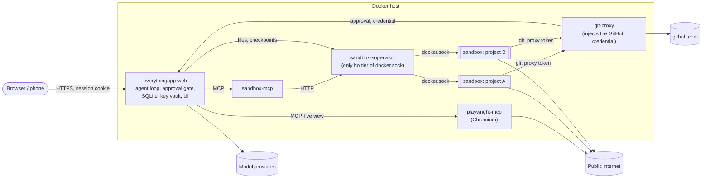

# EverythingApp

[](https://github.com/prod-explore/everything-app/actions/workflows/ci.yml)

A self-hosted AI workspace for one person: chat with any OpenAI-compatible model using your own keys, and let it run
shell commands in a Docker sandbox, drive a browser, push to GitHub and work on a schedule. Every action with a side effect
waits for your approval unless you have allowed it. API keys, the Docker socket and GitHub credentials never enter the
sandbox.

[[Q1: One or two sentences on status: do you use it daily, on what machine, since when, for how many people?]]


<details>
<summary>More screenshots</summary>

| | |
|---|---|
|  |  |
| A question from the agent, answered in the chat or later in the inbox | Providers and model slots |
|  |  |
| Full-text search across chats | Phone layout (installable as a web app) |

All screenshots were taken against the scripted mock model in `tools/mock-llm` (see the quick start).
[[Q3: Do you have screenshots of the sandbox, an approval card, the live browser view or Gazeta that show no private data? They show what the mock cannot.]]

</details>

## What it does

- **Any model behind an OpenAI-compatible API.** A provider is a base URL and a key: OpenAI, OpenRouter, a gateway, Ollama,
  vLLM or LM Studio on your LAN. Models come from the provider's `/models` list, and a chat can switch models at any point
  because history is stored in one format of the app's own. Models that cannot call tools are not offered.
  [Providers, models and slots](docs/providers.md).
- **A sandbox per project.** One container per project (or per standalone chat) with a persistent `/workspace`: a shell,
  git, terminals, a file explorer, a Source Control panel, and a checkpoint before every turn that you can roll back to.
  Deleting a project lists exactly what goes (chats, running agents, scheduled tasks, Gazeta items, processes, workspace
  files with sizes) and then removes all of it, sandbox included.
- **Approvals as cards.** Shell commands are judged one sub-command at a time; anything not allowed by a rule or an earlier
  grant shows a card: allow once, for this chat, for this project, or always, and the card says which commands a grant
  covers (every `git commit …`). Destructive commands (`rm`, `git reset`, `git push`, `kill`…) can only be allowed once
  or for this chat, and destructive-looking calls always ask.
- **Web access.** `web_search` (SearXNG or Brave) and `web_fetch`, plus a Chromium the agent drives and you can watch or
  take over. A new domain asks before the first request to it.
- **Worker agents.** The assistant can start workers with a subset of its own tools, wait for them and message them,
  within depth, count, step and token limits.
- **An inbox (Gazeta).** Questions the agent asks you, reports it posts, approvals that are waiting, and a daily digest.
  A webhook (ntfy, Discord, Slack) can tell your phone that something is waiting.
- **Scheduled tasks.** A prompt plus a cron expression or a moment; each run is an ordinary chat and its answer lands in
  the inbox. The agent can also wake itself up later in the same chat.
- **Ghost chats.** Chats and projects that only ever talk to models marked as running on your own hardware, without web,
  browser or third-party connectors. The flag cannot be turned off once set.
- **Connectors.** Any MCP server, added by URL in Settings.

## Try it locally

This runs the web app as a plain chat (no sandbox, no browser) against a scripted model, so nothing needs an API key or
Docker. Requires Node.js 22 (`better-sqlite3` compiles from source where no prebuilt binary exists, which needs Python and a
C++ toolchain).

```sh
git clone https://github.com/prod-explore/everything-app.git
cd everything-app
(cd web && npm ci && npm run build)
(cd cli && npm ci && npm run build)

# A scripted OpenAI-compatible model on 127.0.0.1:4010. No key, no network.
node tools/mock-llm/server.mjs &

cd cli
cat > .env <<EOF
SERVER_AUTH_TOKEN=$(openssl rand -hex 32)
SERVER_PASSWORD=pick-a-password
KEY_VAULT_SECRET=$(openssl rand -hex 32)
EOF
npm run server
```

Open <http://127.0.0.1:3000>, log in with the password, and add a provider in *Settings → Models → + Add provider* with the
base URL `http://127.0.0.1:4010/v1` and no key. Then try `long`, `todo`, `ask: which database?`, `plan: add a login page`
or `spawn`; the header of [`tools/mock-llm/server.mjs`](tools/mock-llm/server.mjs) lists every scripted reply. Add a real
provider the same way when you want real answers.

The server binds to `127.0.0.1` and stores its data in `~/.everythingapp` (`EVERYTHINGAPP_DB_PATH` moves the database).
[`cli/.env.example`](cli/.env.example) documents every variable.

## Run the full stack

The sandbox, the browser and GitHub access need Docker. On a Linux host with Docker Compose:

```sh
cp .env.example .env
for k in MCP_API_KEY PLAYWRIGHT_MCP_API_KEY SUPERVISOR_TOKEN GIT_PROXY_ADMIN_TOKEN SERVER_AUTH_TOKEN KEY_VAULT_SECRET; do
  sed -i "s/^$k=$/$k=$(openssl rand -hex 32)/" .env
done
sed -i "s/^SERVER_PASSWORD=$/SERVER_PASSWORD=pick-a-password/" .env
sed -i "s/^DOCKER_GID=.*/DOCKER_GID=$(stat -c '%g' /var/run/docker.sock)/" .env

docker build -t everything-sandbox:latest ./sandbox-supervisor/sandbox-image/
docker compose up -d --build
```

Compose refuses to start while a required secret is empty, and every service refuses a weak one. Open
<http://127.0.0.1:3000>, add a provider, and ask for something that needs a shell: the first command shows an approval card.

Instead of building, `deploy/deploy.sh` pulls the images CI publishes for amd64 and arm64, starts them and rolls back a
service that does not become healthy. [[Q2: Are the ghcr.io/prod-explore/everythingapp-* images public, so that this works without logging in?]]

Before the app is reachable from other machines, read [docs/deployment.md](docs/deployment.md): the reverse proxy
(`/internal/` must stay private), the egress guard that keeps the browser and sandboxes off your LAN, GitHub access from
sandboxes, backups and sizing.

## How it works



The web service (`cli/`, Express 5 and SQLite) is the orchestrator: it runs the agent loop, asks for approvals, stores
everything and serves the React UI from `web/`. Tools come from MCP servers. Two of them ship in this repository: the
sandbox (`sandbox-mcp` in front of `sandbox-supervisor`) and the browser (`playwright-mcp`). The rest of the stack exists so
that the process holding your keys never runs agent code and the processes running agent code hold no keys.

| Directory | What it is |
|---|---|
| [`cli/`](cli) | Orchestrator: HTTP API, SSE, agent loop, approval gate, provider adapter, scheduler, MCP client |
| [`web/`](web) | React 19 UI ([web/README.md](web/README.md)) |
| [`sandbox-supervisor/`](sandbox-supervisor) | Creates, stops and limits sandbox containers; checkpoints, terminals, file reads |
| [`sandbox-mcp/`](sandbox-mcp) | MCP tools `run_bash`, `git_op`, `read_log`, `checkpoint_list`, `rollback`, terminals |
| [`playwright-mcp/`](playwright-mcp) | Browser agent tools, live view, URL guard |
| [`git-proxy/`](git-proxy) | Git smart-HTTP proxy to github.com ([git-proxy/README.md](git-proxy/README.md)) |
| [`deploy/`](deploy) | Update with rollback, backup, egress guard, nginx example |
| [`docs/adr/`](docs/adr) | Architecture decision records |

### Decisions that shaped it

- **One wire format, no vendor SDKs.** Messages are stored as the app's own content blocks; one adapter speaks
  chat-completions to every provider. Any chat continues on any model. The cost: provider quirks belong in a gateway in front
  of the provider, and vendor-only features (prompt caching breakpoints, batch APIs, server-side search) are not used.
  [ADR 0001](docs/adr/0001-canonical-message-format.md), [ADR 0008](docs/adr/0008-unified-provider-catalog.md).
- **Approve commands, not tools.** An "always" on `run_bash` would let every command through, so the command policy splits
  a command line into sub-commands (`a && b | $(c)`) and the whole line is only as permitted as its least permitted part.
  This is a gate in front of the sandbox, not the boundary: the container is. [command-policy.ts](cli/src/command-policy.ts).
- **Text-file edits need no approval.** `read_file`, `edit_file` and `write_file` only reach the chat's own `/workspace`,
  never `.git`, and a checkpoint is taken before each turn, so the safety net is the rollback, not a click per edit.
  [ADR 0010](docs/adr/0010-file-tools-and-connectors.md).
- **Loosening policy needs file access.** Always-allow and always-block lists live in `policy.json` next to the database
  (re-read on change), not in the UI, so a prompt-injected agent cannot talk you into a settings change.
  [ADR 0002](docs/adr/0002-policy-file-not-ui.md).
- **No model between a web page and the agent.** Page text is sanitised, cut to length, wrapped as untrusted data and scored
  by a deterministic injection heuristic; a flagged page makes every following side effect ask again. Approval is per
  domain, and `web_fetch` opens without asking only addresses the user typed or a search returned, so the model cannot send
  data to an address it composed. [ADR 0012](docs/adr/0012-web-access.md).
- **Ghost is a database invariant.** A trigger rejects any update of the ghost flag, and "local" must be stated positively
  (by you or by the provider), never inferred. [ADR 0013](docs/adr/0013-ghost-mode.md).
- **Unattended runs use the same gate.** A scheduled run can do what you already allowed; anything else is refused or waits
  in the inbox for a set time. [ADR 0016](docs/adr/0016-scheduled-tasks.md).

## Security model

What the design claims, and what [SECURITY.md](SECURITY.md) treats as a vulnerability when broken:

- **Sandbox isolation.** Sandboxes run as uid 1000 with all capabilities dropped, `no-new-privileges`, Docker's default
  seccomp profile, a read-only root filesystem, memory, CPU and process limits, no host mounts and no Docker socket
  ([docker.ts](sandbox-supervisor/src/docker.ts)). They sit on their own bridge with container-to-container traffic off.
  gVisor is optional (`SANDBOX_RUNTIME=runsc`).
- **No secrets in the sandbox.** Provider keys are encrypted with AES-256-GCM in the database, under `KEY_VAULT_SECRET`
  from the environment. The sandbox gets neither, nor a GitHub credential: git authenticates to git-proxy with a short-lived
  token bound to the project, and git-proxy adds the real credential on the way to GitHub.
- **No private network from the agent.** `web_fetch` checks the resolved address at connection time (DNS rebinding cannot
  switch it), and the browser refuses private, loopback, link-local and metadata addresses. `deploy/egress-guard.sh` enforces
  the same at the network layer for the browser and the sandboxes.
- **Authentication everywhere.** The UI uses an HttpOnly, `SameSite=Strict` session cookie (only its hash is stored); the
  API also takes a bearer token for scripts. Each internal service has its own token, compared in constant time. Services
  refuse weak secrets at startup, and every port is published on `127.0.0.1` only.
- **Side effects need a human or a rule.** Tools are default-deny except a short list of read-only and browser tools. The
  decision, by rule, grant or person, is written to an audit log.

Not covered: an operator who weakens the setup, what a model does within limits a person approved, and a hostile page on a
domain you allowed, which can still receive data the agent sends it. A sandbox can reach the public internet; commands that
do so ask first, but once approved they run.

## Known limits

- **One user.** One password, no accounts or roles.
- **Tool-calling models only**, over chat-completions. No prices are tracked, only tokens; spending limits belong to the
  provider or gateway.
- **Runs are not resumed.** A restart marks running turns and workers as interrupted. git-proxy keeps its tokens in memory,
  so a restart revokes them (the orchestrator issues new ones).
- **GitHub only** for git through the proxy. Signed pushes are refused; force pushes are not always detectable (see
  [git-proxy/README.md](git-proxy/README.md#limitations-v1)).
- **Checkpoints skip nested repositories** inside the workspace (git records them as gitlinks).
- **`web_fetch` reads HTML, JSON and text only**, and runs no JavaScript; the browser covers the rest. Browser profiles are
  ephemeral, so logins do not persist.
- **The network guard is IPv4 iptables on Linux.**
- **A ghost chat is only as local as its labels.** A provider or gateway that marks a cloud model as local defeats it.
- **Schedules do not run while the app is down.** A slot missed by up to two hours runs late; older ones are skipped.

## Development

Each directory is its own npm package; there is no workspace tool. CI runs, per package:

```sh
cd cli && npm ci && npm test              # same for git-proxy, sandbox-mcp, sandbox-supervisor, playwright-mcp
cd web && npm ci && npx tsc -b && npm run lint && npm test && npx vite build
```

Backend tests use `node:test` with fakes in place of the model, Docker and the browser, so they need no Docker daemon, no
Chromium download and no API key (CI runs them with `PLAYWRIGHT_SKIP_BROWSER_DOWNLOAD=1`). For UI work, run
`npm run dev` in `web/` (Vite on port 5173, proxying `/api` to `http://localhost:3000`) next to the server from the quick
start. CI also validates the compose file, runs `npm audit` on runtime dependencies, builds every Docker image and runs
CodeQL and gitleaks ([workflows](.github/workflows)).

`tools/screenshots.mjs` regenerates `docs/img/` against the mock model.

## License

[MIT](LICENSE)
